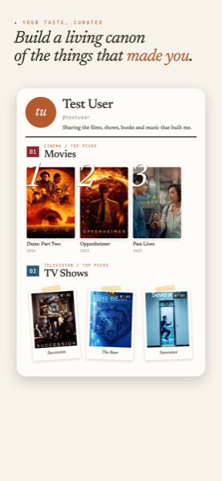
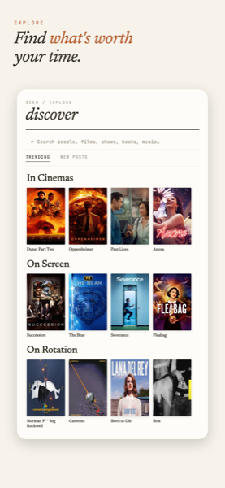
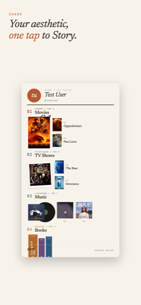
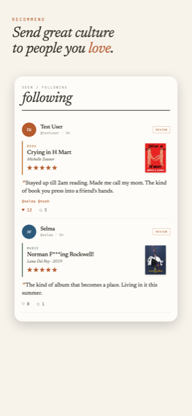
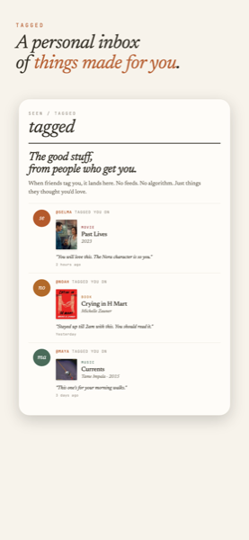
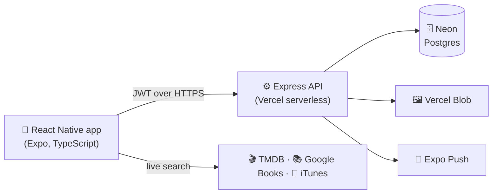

# ✦ SEEN

### *culture worth sharing*

A culture-sharing iOS app where you curate your taste in **film, TV, books and music** —
and recommend it directly to the friends who'll love it. No algorithm. No feed-chasing.
Just your taste, sent to the people who get you.

&nbsp;

---

  
  
  
  
  

## What it does

- **Build a taste profile** — your top picks across Movies, TV, Books and Music, searched live from real catalogs
- **Recommend to friends** — tag someone on anything worth their time; it lands in their personal *Tagged* inbox
- **Two gentle feeds** — *Following* (people you trust) and *Discover* (new taste), no infinite scroll
- **One-tap share card** — export your taste as an Instagram Story in the app's own aesthetic
- **The essentials** — Sign in with Apple, push notifications, dark mode, profile photos, and full account controls

## Tech stack

| Layer | Built with |
|---|---|
| **Mobile app** | React Native (Expo SDK 54), TypeScript, React Navigation, Reanimated |
| **Backend** | Node.js / Express, deployed serverless on Vercel |
| **Database** | Neon Postgres with Prisma ORM |
| **Auth** | JWT sessions + Sign in with Apple |
| **Image storage** | Vercel Blob |
| **Push** | Expo Notifications |
| **External data** | TMDB (film/TV), Google Books, iTunes (music) |
| **Build & delivery** | EAS Build / Submit, EAS Update (OTA) |

## Architecture

## Status

**Live on the App Store** — available in the US, UK, Canada, Australia and Türkiye.
Shipped end-to-end: real database, authentication, push notifications, legal pages and
over-the-air updates.

## About

Designed and built by **Selma Nur Keskin**.

This product uses the TMDB API but is not endorsed or certified by TMDB. Artwork and
metadata belong to their respective rights holders.
